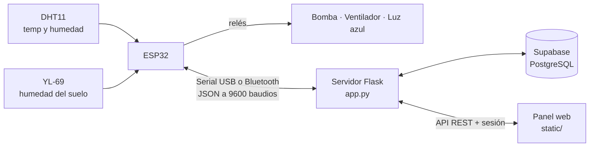

# THERMOONE
Sistema IoT para el monitoreo ambiental y el riego automatizado de plantas en viveros e invernaderos. Desarrollado como proyecto de grado del técnico en Desarrollo de Software del SENA.

Un ESP32 lee la temperatura, la humedad del aire y la humedad del suelo, y controla una bomba de riego, un ventilador y una luz azul. Un servidor en Flask recibe los datos, aplica reglas automáticas, guarda el historial en Supabase y muestra todo en un panel web protegido con inicio de sesión, que funciona desde el celular o el computador.

## Características

- **Panel en vivo:** temperatura, humedad del aire y del suelo, estado del suelo, tiempo desde el último riego y estado de la conexión con el ESP32.
- **Control manual:** botones para regar, encender o apagar el ventilador y la luz azul.
- **Modo automático:**
  - Riego por humedad del suelo, con umbral, objetivo, duración y tiempo de espera configurables.
  - Riego opcional por intervalo de tiempo.
  - Ventilador por temperatura, con histéresis (se enciende y se apaga a temperaturas distintas).
  - Luz azul programada por horario.
- **Historial** de lecturas y eventos en Supabase (PostgreSQL).
- **Análisis:** promedios, máximos y mínimos, tendencia de temperatura por hora, proyección a 1 hora, riegos del día y porcentaje de tiempo con el ventilador encendido, con gráfica.
- **Configuración desde la web:** los parámetros se guardan en `config.json` y se conservan al reiniciar. Hay un botón para restaurar los valores por defecto.
- **Acceso protegido:** página de inicio de sesión propia, sesión de 12 horas y bloqueo temporal tras varios intentos fallidos.
- **Interfaz responsive** pensada también para usarla desde el celular.

## Arquitectura



El ESP32 envía cada 2 segundos una línea JSON con las lecturas y el estado de los actuadores, y recibe comandos de texto. El servidor guarda las lecturas en segundo plano para que la base de datos nunca bloquee la lectura del puerto serial.

## Hardware

| Componente | Función |
|---|---|
| ESP32 (Dev Module, clásico) | Microcontrolador. Lee sensores, maneja los relés y se comunica por USB o Bluetooth |
| DHT11 | Temperatura y humedad del aire |
| YL-69 (sensor de humedad del suelo) | Humedad del suelo, lectura analógica |
| Módulo de 3 relés | Conmuta la bomba, el ventilador y la luz azul |
| Bomba de riego, ventilador y luz azul | Actuadores |

### Conexiones

| Pin del ESP32 | Conectado a |
|---|---|
| GPIO 4 | Dato del DHT11 |
| GPIO 34 | Salida analógica (AO) del YL-69 |
| GPIO 33 | Alimentación (VCC) del YL-69 |
| GPIO 25 | Relé 1: bomba |
| GPIO 26 | Relé 2: ventilador |
| GPIO 27 | Relé 3: luz azul |

Detalles de diseño:

- **Los relés se activan en nivel bajo (LOW).** Al arrancar, el firmware pone los pines en HIGH antes de configurarlos como salida, para que nada se encienda solo.
- **El YL-69 solo se alimenta durante la medición** (GPIO 33). Esto reduce la corrosión de las sondas, que es lo que acorta la vida de este sensor.
- **Seguridad de la bomba:** el firmware la apaga por su cuenta si lleva más de 30 segundos encendida. El servidor también impide encender la bomba y el ventilador al mismo tiempo.

## Firmware (ESP32)

El código está en `riego_prueba/riego_prueba.ino`.

1. Instala el soporte para ESP32 en el IDE de Arduino y selecciona la placa **ESP32 Dev Module**.
2. Instala las librerías **DHT sensor library** y **Adafruit Unified Sensor** (de Adafruit).
3. Sube el sketch. El monitor serie funciona a **9600** baudios.
4. El ESP32 también se anuncia por Bluetooth con el nombre **RiegoESP32**.

Comandos aceptados (texto, terminados en salto de línea): `B1`/`B0` bomba, `F1`/`F0` ventilador, `L1`/`L0` luz.

## Instalación del servidor

Requisitos: Python 3.10 o superior y una cuenta gratuita de [Supabase](https://supabase.com).

```bash
git clone https://github.com/juangarzonaprendizsena/THERMOONE.git
cd THERMOONE
python -m venv venv
venv\Scripts\activate        # En Linux o macOS: source venv/bin/activate
pip install -r requirements.txt
```

### Base de datos

1. Crea un proyecto en Supabase.
2. Abre el **SQL Editor** y ejecuta el contenido de `supabase.sql`. Crea las tablas `lecturas` y `eventos`.
3. Copia la URL del proyecto y la clave de API desde **Project Settings → API**.

> `supabase.sql` activa Row Level Security. El servidor corre en tu propio equipo, así que usa la clave que corresponda a tus políticas y nunca la subas al repositorio.

### Variables de entorno

Copia el archivo de ejemplo y completa tus valores:

```bash
cp .env.example .env         # En Windows: copy .env.example .env
```

| Variable | Descripción | Ejemplo |
|---|---|---|
| `SUPABASE_URL` | URL de tu proyecto de Supabase | `https://tu-proyecto.supabase.co` |
| `SUPABASE_KEY` | Clave de API de Supabase | *(tu clave)* |
| `PUERTO` | Puerto serie del ESP32 (USB o el COM de Bluetooth) | `COM8` |
| `PANEL_USER` | Usuario para entrar al panel | `admin` |
| `PANEL_PASSWORD` | Contraseña del panel. Usa una larga y aleatoria | *(tu contraseña)* |
| `SECRET_KEY` | Clave que firma las cookies de sesión | *(valor aleatorio)* |

Puedes generar valores seguros para la contraseña y la clave de sesión con:

```bash
python -c "import secrets; print(secrets.token_urlsafe(16))"   # contraseña
python -c "import secrets; print(secrets.token_hex(32))"       # SECRET_KEY
```

El archivo `.env` está en el `.gitignore` y **no debe subirse nunca**. Sin las variables de Supabase el sistema sigue funcionando, pero sin historial ni análisis. Si falta `PANEL_PASSWORD`, el panel queda sin protección y el servidor lo avisa al arrancar.

Para ver el puerto del ESP32 en Windows, abre el **Administrador de dispositivos → Puertos (COM y LPT)**.

## Uso

```bash
python app.py
```
Comando para el tunel : cloudflared tunnel --url http://localhost:5000

Abre `http://localhost:5000`, inicia sesión y el panel cargará. Cuando el ESP32 esté conectado, el indicador de arriba pasará a **ESP32 conectado**. El botón **Salir** cierra la sesión.

### Secciones del panel

- **Panel en vivo:** lecturas y botones de control.
- **Datos guardados:** historial de lecturas.
- **Análisis:** estadísticas y gráfica.
- **Configuración:** parámetros del modo automático.

### Configuración del modo automático

Estos son los valores por defecto de `config.json`:

| Parámetro | Valor | Significado |
|---|---|---|
| `riego_por_humedad` | `true` | Riega cuando el suelo está seco |
| `umbral_riego` | `30` | Humedad del suelo (%) por debajo de la cual se riega |
| `objetivo_pct` | `60` | Humedad (%) que se busca alcanzar |
| `riego_s` | `5` | Segundos que dura cada riego |
| `espera_min` | `10` | Minutos de espera entre riegos |
| `riego_por_tiempo` | `false` | Riego por intervalo fijo |
| `intervalo_min` | `360` | Minutos entre riegos por tiempo |
| `fan_auto` | `true` | Ventilador automático |
| `t_fan_on` / `t_fan_off` | `28.0` / `26.0` | Temperaturas (°C) para encender y apagar el ventilador |
| `luz_auto` | `false` | Luz azul por horario |
| `luz_on` / `luz_off` | `18:00` / `06:00` | Horario de la luz |
| `guardar_s` | `180` | Segundos entre registros en la base de datos |
| `suelo_seco` / `suelo_humedo` | `4095` / `2500` | Calibración del YL-69 (lectura en seco y en agua) |

Calibra el YL-69 midiendo el valor con el sensor al aire y dentro de agua, y ajusta `suelo_seco` y `suelo_humedo`.

## Demo con acceso temporal desde internet

Para mostrar o probar el panel desde otro dispositivo sin abrir puertos del router, se usa un túnel de [Cloudflare](https://developers.cloudflare.com/cloudflare-one/connections/connect-networks/):

```bash
cloudflared tunnel --url http://localhost:5000
```

El comando entrega una dirección `https://...trycloudflare.com` que cambia cada vez y deja de funcionar al cerrarlo. El acceso queda protegido por el inicio de sesión del panel.

## Seguridad

- **Autenticación:** inicio de sesión con sesión firmada en cookie (`HttpOnly`, `SameSite=Lax`) que dura 12 horas.
- **Toda la API exige sesión**, incluidos los comandos que accionan la bomba, el ventilador y la luz. Sin sesión, la API responde 401 y las páginas redirigen a `/login`.
- **Fuerza bruta:** pausa de 1 segundo por intento fallido y bloqueo de 5 minutos tras 5 fallos seguidos.
- **Comparación de credenciales en tiempo constante** (`hmac.compare_digest`).
- **Secretos fuera del código:** `.env` en el `.gitignore` y plantilla `.env.example` sin valores reales.
- **Protección física:** la bomba se apaga sola a los 30 segundos desde el firmware.

Limitaciones conocidas: hay una sola cuenta, sin verificación en dos pasos, y el control de intentos vive en memoria (se reinicia con el servidor). El servidor de desarrollo de Flask no está pensado para producción: en un despliegue real conviene usar un servidor como Waitress o Gunicorn detrás de HTTPS.

## API

| Método | Ruta | Descripción |
|---|---|---|
| GET | `/login` | Página de inicio de sesión (pública) |
| POST | `/api/login` | Inicia sesión (pública) |
| POST | `/api/logout` | Cierra la sesión |
| GET | `/` | Panel web |
| GET | `/api/estado` | Estado actual y lecturas en vivo |
| POST | `/api/cmd` | Envía un comando al ESP32 |
| GET | `/api/historial` | Últimas lecturas guardadas |
| GET | `/api/analisis` | Estadísticas y proyección |
| GET / POST | `/api/config` | Lee o guarda la configuración |
| POST | `/api/config/reset` | Restaura los valores por defecto |

Todas las rutas, salvo las dos públicas, requieren sesión iniciada.

## Estructura del proyecto

```
THERMOONE/
├── app.py                  # Servidor Flask, sesiones, lector serial, reglas automáticas y API
├── config.json             # Parámetros del modo automático
├── requirements.txt        # Dependencias de Python
├── supabase.sql            # Tablas de la base de datos
├── .env.example            # Plantilla de variables de entorno
├── .gitignore              # Excluye .env y archivos temporales
├── static/
│   ├── index.html          # Panel web
│   └── login.html          # Página de inicio de sesión
└── riego_prueba/
    └── riego_prueba.ino    # Firmware del ESP32
```

## Tecnologías

Python · Flask · pyserial · pandas · NumPy · Supabase (PostgreSQL) · HTML, CSS y JavaScript · Chart.js · ESP32 (C++ / Arduino) · Cloudflare Tunnel

## Mejoras futuras

- Verificación en dos pasos y gestión de varios usuarios.
- Notificaciones cuando el suelo esté muy seco o la temperatura sea extrema.
- Reemplazar el DHT11 por un sensor más preciso (DHT22 o BME280) y el YL-69 por un sensor capacitivo.
- Comunicación por WiFi o MQTT en lugar de serial y Bluetooth.
- Despliegue con un servidor de producción y HTTPS propio.


